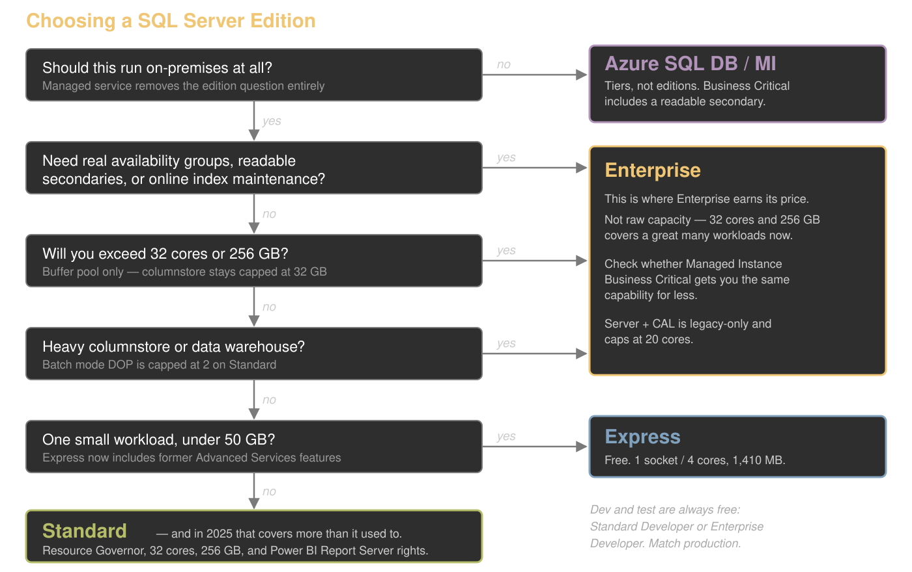

# The Edition Decision Guide

Companion reference for [Pick Your Poison: Choosing the Right Edition of SQL Server](https://csmore.info/on/editions).

**Accurate as of:** _2026-10-10_

---

## Work the questions in this order

Order matters. Most teams start with budget and back into an architecture, which is
how you end up with an edition that cannot do what the design assumed.

### 1. Should this run on-premises at all?

If a managed service fits, the edition question disappears and becomes a service tier
question. Azure SQL Database offers General Purpose, Business Critical, and Hyperscale
(now the recommended default for new OLTP and HTAP workloads). Managed Instance offers
General Purpose, Next-gen General Purpose, and Business Critical.

Two things worth knowing before you dismiss this:

- **Business Critical includes a readable secondary replica.** Effectively twice the
  vCores and memory for the same price if you can separate read-write from read-only
  traffic. On-premises, that readable secondary is an Enterprise-only Always On feature.
- **Managed Instance has a license-free DR benefit.** Designate a secondary as DR-only
  and skip vCore licensing on it — the cloud answer to the on-premises passive replica trap.

> **Naming trap.** The DTU model's "Standard" tier has nothing to do with Standard
> edition. Different product, different axis, same word.

### 2. What are the HA/DR requirements?

**This is the question that actually decides Enterprise**, and 2025 did not change it.

| Requirement | Standard | Enterprise |
|---|---|---|
| Basic AG (2 replicas, 1 database, non-readable secondary) | Yes | — |
| Always On availability groups | **No** | Yes |
| Readable secondary | **No** | Yes |
| Contained / distributed AGs | **No** | Yes |
| Failover cluster instance | 2 nodes | 16 nodes |

If you need a readable secondary or more than one database in an availability group,
you need Enterprise. Azure SQL Managed Instance Business Critical may also be a viable option.

### 3. What is the capacity ceiling, and which cap actually binds?

Standard 2025: lesser of 4 sockets or **32 cores**, **256 GB buffer pool**.

The trap is assuming 256 GB is your whole memory budget. It is the buffer pool only.
Columnstore segment cache and memory-optimized data per database remain capped at
**32 GB each**, and did not move in 2025.

### 4. Is this a data warehouse workload?

Batch mode degree of parallelism is capped at **2 on Standard** and **1 on Express**.
Star join optimization, parallel query processing on partitioned tables, and global
batch aggregation are all Enterprise-only.

A columnstore warehouse on Standard runs, and runs at half the parallelism. This is
the most common source of "we bought Standard and it is slow."

### 5. Do you need on-premises reporting?

Power BI Report Server now comes with **Standard and Enterprise under any license
type**. Before 2025 it required Enterprise plus active Software Assurance.

If reporting was your reason for Enterprise, re-examine it. This may be the single
largest practical change in the release.

### 6. What license type do you hold?

Edition is no longer the only axis. Software Assurance or a SQL Server subscription
gates Best Practices Assessment, point-in-time restore, automated backups, automatic
updates, the passive replica benefit, unlimited virtualization, and free version
upgrades. See `licensing-compliance-checklist.md`.

### 7. Then budget

Enterprise runs roughly **4× Standard per core** at list. Verify against your own
agreement — real pricing is EA- or CSP-negotiated and list prices are neither stable
nor reliably public.

That ratio is the only number you need. A 16-core Enterprise instance and a 64-core
Standard instance cost about the same, which reframes "we need more cores" as a
question rather than an answer.

---

## Converting licenses you already own

Azure Hybrid Benefit turns "which edition do I own" into "what can I run in Azure."
Requires active Software Assurance or a subscription.

| You own | You get |
|---|---|
| 1 Standard edition core | 1 General Purpose core |
| 1 Enterprise edition core | 1 Business Critical core |
| 1 Enterprise edition core | 4 General Purpose cores |
| 4 General Purpose cores | 1 Enterprise edition core |

That third row is the interesting one. Enterprise licenses convert to four times the
General Purpose capacity, which can make a cloud migration cheaper than the on-premises
renewal it replaces.

---

## The hybrid middle ground

The **Managed Instance link feature** uses distributed availability group technology
and works on **Standard as well as Enterprise** in 2025.

A Standard shop can offload read workloads to Azure, or establish DR there, without
buying Enterprise. This is genuinely underused and it is often the cheapest answer to
"we need a readable secondary."

---

## Common mistakes

- **Buying Enterprise "just in case."** Run the audit first. If you have no AG, no
  online maintenance window problem, and you fit inside 32 cores, you may be paying
  4× for nothing.
- **Assuming 2025 Standard got real availability groups.** It did not.
- **Misreading `sys.dm_db_persisted_sku_features` in either direction.** Rows are not
  blockers — on 2025 it flags six features that all run fine on Standard. And zero rows
  are not permission, because it only answers *"will it restore."* See
  `edition-change-runbooks.md`.
- **Ignoring Express limits until production.** 50 GB arrives faster than you expect.
- **Letting Developer edition drift into production.** A licensing violation, and an
  easy one to commit accidentally.
- **Choosing the edition after the architecture.** The edition constrains what you can
  build. Decide first.
